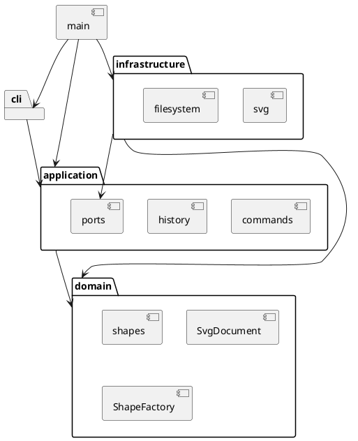

# SVG 编辑器 Phase 1：架构与开发记录

## 运行环境与入口

Node.js 22 或更新版本，npm。安装依赖后使用 `npm run cli`；构建后使用 `npm start`。`npm run check` 统一运行类型检查、测试和构建。

交互输入提示符为 `svg>`，Ctrl+D（Windows 也可以使用 Ctrl+Z 后回车）结束输入。支持从标准输入回放命令文件。生成文件建议放入被 Git 忽略的 `output/`。

## 架构方案

### 模块职责和依赖方向

| 模块 | 职责 | 允许依赖 |
|---|---|---|
| `domain` | 图形多态、树结构、数值约束、快照复制 | 领域内部 |
| `application` | 编辑命令、会话、历史、查询显示、外部能力接口 | domain |
| `cli` | 分词、输入读取、将错误转换为单行反馈 | application |
| `infrastructure` | XML 和文件系统适配 | application 端口、domain |
| `main.ts` | 组装并启动 | 上述模块 |

领域不得依赖 Node 文件系统、XML 库或 CLI；应用层不得直接依赖基础设施。文件系统和 SVG 编解码器通过端口注入。输出格式查询放在 application 中，CLI 不直接改领域对象。

### 设计模式

- **Command**：每条编辑命令有独立类，由执行器触发，历史条目记录该命令及前后快照。命令只修改候选文档，成功才替换当前文档并记录历史。
- **Composite**：`Group` 与叶子继承 `Shape`；统一移动、缩放、设置样式和复制。容器递归修改子孙的几何值。组的样式保留在组上，按 SVG 自然继承，不覆写子元素的显式样式。
- **Memento**：通过多态深复制保存文档快照；历史恢复不会共享可变图形。代价为每次编辑 O(n) 时间和空间；本阶段先确保正确，不做增量快照。
- **Factory**：`ShapeFactory` 集中处理创建与 SVG 导入的类型名映射。
- **Visitor**：图形通过 `accept` 将自身交给序列化访问者，避免序列化按标签反复分派。文字和属性由 XML 库转义。
- **依赖倒置**：应用只依赖文件和 SVG 编解码端口，测试可以用内存存储模拟 IO 失败。

按名字分派只保留两个入口：应用层命令路由、领域图形工厂。按作业要求，这两处标记为后续插件化阶段待重构点；本阶段用显式注册表，不实现插件发现和加载。

### 变化点假设

| 变化 | 当前准备 | 暂不实现的内容 |
|---|---|---|
| 新图形类型 | 图形抽象、工厂、访问者 | box 和 ShapeProvider 插件体系 |
| 新输入通道 | CLI 与应用命令隔离 | GUI、鼠标和 agent 协议 |
| 新文件格式 | 文件存储、编解码端口 | 多格式发现和自动选择 |
| 大文档历史优化 | 历史管理独立 | 差量快照、历史上限和持久化 |

### 已确定的行为边界

这些是原文未充分定义处的实现决策，不声称是 SVG 全规范支持。

1. 文档操作成功后清空旧历史并禁用 undo/redo；下一次成功编辑重新启用。失败编辑保留 redo 和禁用状态。
2. 保存成功后记住该路径；无参数保存使用最近成功读取或保存的路径。无路径报错，不猜测文件名。
3. 数字必须是有限的十进制数（允许科学计数法）；坐标允许负数，尺寸、半径、stroke-width 非负，画布尺寸和 scale 因子为正。几何运算溢出也拒绝整个命令。
4. group 按原树的深度优先顺序收编节点，而非参数顺序；在共同祖先容器中、最早相关直属分支之前插入新组。同父节点因此替换最早选中节点的位置。祖先和后代同时选择时拒绝。重复选择拒绝。
5. ungroup 仅允许非根级普通 g；子节点在父容器中占据原组位置。组的样式向缺失该样式的直属子节点补齐，维持基本样式继承结果；已有子元素显式样式不覆盖。继承关键字等复杂 CSS 不支持。
6. front 移到同级末尾（SVG 后绘制，在视觉上更前），back 移到开头。
7. help 可在无文档时执行，其他命令均须先 init/read。空历史分别报 nothing to undo/redo。
8. 词法支持双引号、空字符串，以及引号内的 `\"` 和 `\\`。引号外反斜杠保留以兼容 Windows 路径；`#` 只在整行首个非空白字符处表示注释。
9. SVG 仅接受六种内置标签、id、各自几何属性、fill/stroke/stroke-width，以及少量保留的文字呈现属性（font-size/font-family/font-weight/text-anchor/dominant-baseline）。保留的呈现属性可以导入和导出，不扩大 CLI set 白名单。
10. 根元素接受命名空间、width/height、与 `0 0 width height` 一致的 viewBox。尺寸允许裸数或 px；缺少尺寸时可从同原点正尺寸 viewBox 推导。不支持不同坐标系、百分比、其他单位、transform、style、事件、外链、未知属性或标签；明确报错，不静默丢弃。拒绝 DTD、实体定义和处理指令（XML 声明除外）；注释与格式空白可忽略。
11. 已有重复或空 ID 拒绝读取；缺少 ID 才自动补全，且预先收集整个文件的显式 ID，避免后续冲突。根 SVG 不参与图形 ID。
12. 不验证所有 CSS 颜色和字体语法；支持范围内的呈现值作为不透明文本保存。禁止依赖继承关键字、CSS 变量和 URL 引用，防止破坏本阶段的编辑语义。

## 需求验收清单

| 范围 | 实现入口 | 验证 |
|---|---|---|
| init/read/save/canvas | 文档命令 | 默认尺寸、路径、IO 失败、历史禁用 |
| 六种类型和 create in | CreateCommand、ShapeFactory | 类型参数、ID、父容器、样式缺省 |
| delete/move/scale/set | 各编辑命令 | 子树、全几何缩放、白名单、失败原子性 |
| group/ungroup/addto | 结构命令 | 防循环、顺序、跨父级、样式 |
| front/back | 顺序命令 | 序列与浏览器渲染顺序 |
| tree/show/help | 查询命令 | 关键属性、父级、子树、语法 |
| undo/redo | History | 快照独立、单命令单元、redo 清理 |
| SVG 读写 | XmlSvgCodec | XML 校验、中文转义、补 ID、往返一致性 |
| 完整示例 | fixtures | 原文会话、两节点流程图版本 A |

## 过程记录

- 2026-10-27：阅读需求和开发规划，检查本地 Node.js 24.21.0、npm 12.0.2 和干净的 main 分支。仓库已有需求与规划的独立提交。
- 2026-10-27：在编码前明确历史重置、跨父级分组、根级解组限制和导入边界。特别保留“保存后禁止撤销”的作业规则，避免照搬通常编辑器行为。
- 后续记录仅填写实际发生的纠错和验证结果。

## 一致性自查

待实现完成后记录实际目录、依赖检查和方案修订。

## 质量保证手段

计划通过 `npm run check`、需求会话回放、XML 往返比较及浏览器预览验证。当前文档初稿尚不代表检查已通过。

## 交付状态

当前处于本地开发阶段。按阶段保留本地 Git 提交；远程推送与最终 final 标签在交付时处理，不提前将开发中版本标记为最终版。
