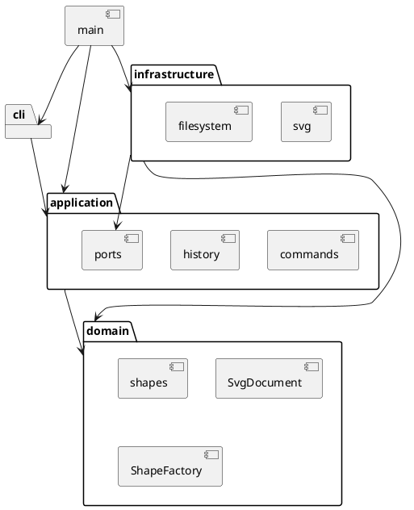

# SVG 编辑器 Phase 1：架构与开发记录

## 运行环境与入口

Node.js 22 或更新版本，npm。安装依赖后使用 `npm run cli`；构建后使用 `npm start`。`npm run check` 统一运行类型检查、测试和构建。

交互输入提示符为 `svg>`，Ctrl+D（Windows 也可以使用 Ctrl+Z 后回车）结束输入。支持从标准输入回放命令文件。生成文件建议放入被 Git 忽略的 `output/`。

## 架构方案

### 模块职责和依赖方向

| 模块 | 职责 | 允许依赖 |
|---|---|---|
| `domain` | 图形多态、树结构、数值约束、快照复制 | 领域内部 |
| `application` | 编辑命令、会话、历史、查询显示、外部能力接口 | domain |
| `cli` | 分词、输入读取、将错误转换为单行反馈 | application |
| `infrastructure` | XML 和文件系统适配 | application 端口、domain |
| `main.ts` | 组装并启动 | 上述模块 |



领域不得依赖 Node 文件系统、XML 库或 CLI；应用层不得直接依赖基础设施。文件系统和 SVG 编解码器通过端口注入。输出格式查询放在 application 中，CLI 不直接改领域对象。

### 设计模式

- **Command**：每条编辑命令有独立类，由执行器触发，历史条目记录该命令及前后快照。命令只修改候选文档，成功才替换当前文档并记录历史。
- **Composite**：`Group` 与叶子继承 `Shape`；统一移动、缩放、设置样式和复制。容器递归修改子孙的几何值。组的样式保留在组上，按 SVG 自然继承，不覆写子元素的显式样式。
- **Memento**：通过多态深复制保存文档快照；历史恢复不会共享可变图形。代价为每次编辑 O(n) 时间和空间；本阶段先确保正确，不做增量快照。
- **Factory**：`ShapeFactory` 集中处理创建与 SVG 导入的类型名映射。
- **Visitor**：图形通过 `accept` 将自身交给序列化访问者，避免序列化按标签反复分派。文字和属性由 XML 库转义。
- **依赖倒置**：应用只依赖文件和 SVG 编解码端口，测试可以用内存存储模拟 IO 失败。

按名字分派只保留两个入口：应用层命令路由、领域图形工厂。按作业要求，这两处标记为后续插件化阶段待重构点；本阶段用显式注册表，不实现插件发现和加载。

### 变化点假设

| 变化 | 当前准备 | 暂不实现的内容 |
|---|---|---|
| 新图形类型 | 图形抽象、工厂、访问者 | box 和 ShapeProvider 插件体系 |
| 新输入通道 | CLI 与应用命令隔离 | GUI、鼠标和 agent 协议 |
| 新文件格式 | 文件存储、编解码端口 | 多格式发现和自动选择 |
| 大文档历史优化 | 历史管理独立 | 差量快照、历史上限和持久化 |

### 已确定的行为边界

这些是原文未充分定义处的实现决策，不声称是 SVG 全规范支持。

1. 文档操作成功后清空旧历史并禁用 undo/redo；下一次成功编辑重新启用。失败编辑保留 redo 和禁用状态。
2. 保存成功后记住该路径；无参数保存使用最近成功读取或保存的路径。无路径报错，不猜测文件名。
3. 数字必须是有限的十进制数（允许科学计数法）；坐标允许负数，尺寸、半径、stroke-width 非负，画布尺寸和 scale 因子为正。几何运算溢出也拒绝整个命令。
4. group 按原树的深度优先顺序收编节点，而非参数顺序；在共同祖先容器中、最早相关直属分支之前插入新组。同父节点因此替换最早选中节点的位置。祖先和后代同时选择时拒绝。重复选择拒绝。
5. ungroup 仅允许非根级普通 g；子节点在父容器中占据原组位置。组的样式向缺失该样式的直属子节点补齐，维持基本样式继承结果；已有子元素显式样式不覆盖。继承关键字等复杂 CSS 不支持。
6. front 移到同级末尾（SVG 后绘制，在视觉上更前），back 移到开头。
7. help 可在无文档时执行，其他命令均须先 init/read。空历史分别报 nothing to undo/redo。
8. 词法支持双引号、空字符串，以及引号内的 `\"` 和 `\\`。引号外反斜杠保留以兼容 Windows 路径；`#` 只在整行首个非空白字符处表示注释。
9. SVG 仅接受六种内置标签、id、各自几何属性、fill/stroke/stroke-width，以及少量保留的文字呈现属性（font-size/font-family/font-weight/text-anchor/dominant-baseline）。保留的呈现属性可以导入和导出，不扩大 CLI set 白名单。
10. 根元素接受命名空间、width/height、与 `0 0 width height` 一致的 viewBox。尺寸允许裸数或 px；缺少尺寸时可从同原点正尺寸 viewBox 推导。不支持不同坐标系、百分比、其他单位、transform、style、事件、外链、未知属性或标签；明确报错，不静默丢弃。拒绝 DTD、实体定义和处理指令（XML 声明除外）；注释与格式空白可忽略。
11. 已有重复或空 ID 拒绝读取；缺少 ID 才自动补全，且预先收集整个文件的显式 ID，避免后续冲突。根 SVG 不参与图形 ID。
12. 不验证所有 CSS 颜色和字体语法；支持范围内的呈现值作为不透明文本保存。禁止依赖继承关键字、CSS 变量和 URL 引用，防止破坏本阶段的编辑语义。
13. 文字和呈现属性拒绝 XML 1.0 非法控制字符及孤立代理项，允许中文和 emoji。移动到其他容器会按新父级重新继承样式；跨组收编不烘焙原父级的继承样式。

## 需求验收清单

| 范围 | 实现入口 | 验证 |
|---|---|---|
| init/read/save/canvas | 文档命令 | 默认尺寸、路径、IO 失败、历史禁用 |
| 六种类型和 create in | CreateCommand、ShapeFactory | 类型参数、ID、父容器、样式缺省 |
| delete/move/scale/set | 各编辑命令 | 子树、全几何缩放、白名单、失败原子性 |
| group/ungroup/addto | 结构命令 | 防循环、顺序、跨父级、样式 |
| front/back | 顺序命令 | 序列与浏览器渲染顺序 |
| tree/show/help | 查询命令 | 关键属性、父级、子树、语法 |
| undo/redo | History | 快照独立、单命令单元、redo 清理 |
| SVG 读写 | XmlSvgCodec | XML 校验、中文转义、补 ID、往返一致性 |
| 完整示例 | fixtures | 原文会话、两节点流程图版本 A |

## 过程记录

- 2026-10-27：阅读需求和开发规划，检查本地 Node.js 24.21.0、npm 12.0.2 和干净的 main 分支。仓库已有需求与规划的独立提交。
- 2026-10-27：在编码前明确历史重置、跨父级分组、根级解组限制和导入边界。特别保留“保存后禁止撤销”的作业规则，避免照搬通常编辑器行为。
- 2026-10-27：依赖下载在沙箱内发生 DNS 失败，使用已验证的本机代理和正常网络权限安装成功。锁定依赖版本写入 `package-lock.json`；没有把个人代理配置写入工程。
- 2026-10-27：先通过 6 项领域测试，再扩展到命令、历史、SVG 与完整会话测试。XML 转义测试起初错误地假设 `>` 不会转义；检查库的实际输出后，将断言改为合法的 `&gt;`，并继续用读回后的文字验证语义。
- 2026-10-27：真实文件覆盖保存测试在 Windows 沙箱下报 rename EPERM。相同代码在正常本地权限下通过，保留临时文件加 rename 的保存策略，没有用先删除原文件的方式绕过问题。
- 2026-10-27：自查发现任意文字可能包含 XML 非法控制字符，因此补充 `SvgText` 校验及失败原子性测试，确认中文和 emoji 不受影响。另为父节点变更加成员关系检查，避免独立改写父引用破坏树。
- 2026-10-27：补充自动架构检查，实际扫描源文件导入方向、一类一文件和 switch 分派；37 项测试、类型检查和构建全部通过。
- 2026-10-27：用构建后的程序真实回放流程图案例，生成 `output/flowchart.svg`，确认 8 个元素及中文标签正确。内置浏览器拒绝 file 协议，未完成浏览器视觉验收；没有将 XML 测试冒充浏览器预览结果。

## 一致性自查

1. **模块划分**：实际保留 cli/application/domain/infrastructure 四层及 main 组装入口。新增 `Numeric`、`SvgText` 两个领域校验类；查询格式类 `DocumentPresenter` 位于 application，CLI 只处理交互和错误展示。这些是原方案的细化，未改变依赖方向。
2. **依赖方向**：`tests/architecture.test.ts` 扫描全部源文件导入，确认 domain/application 不依赖外部运行库，应用不依赖基础设施，CLI 不直接依赖领域或基础设施；最终检查通过。
3. **多态与分派**：工厂是唯一图形类型名入口；命令路由是唯一命令名入口。图形行为通过类的覆写实现，SVG 输出通过访问者实现，源文件没有 switch 分派。一类一文件检查通过。
4. **历史策略**：由操作候选副本后提交，替代先改当前文档再回滚，减少失败路径的状态恢复风险。历史仍使用前后快照，O(n) 成本与原方案一致。
5. **阶段边界**：没有实现 box、插件加载和 GUI。transform 及更广的 SVG/CSS 支持以明确错误拒绝，属于已记录限制。

## 质量保证手段

2026-10-27 本地验证结果：

| 检查 | 结果 |
|---|---|
| `npm run typecheck` | 通过 |
| `npm test` | 37 项通过，无失败、跳过或待办测试 |
| `npm run build` | 通过，生成 dist/main.js |
| 整体 `npm run check` | 通过 |
| 非交互 CLI 子进程及 EOF | 通过，错误后可继续下一条命令 |
| 需求典型会话 | 通过，仅出现示例预期的两条错误 |
| 两节点流程图版本 A | 通过，保存并读回 8 个图形元素 |
| 真实文件覆盖保存和失败临时文件清理 | 正常本地权限下通过 |
| 实际构建程序回放 | 生成 output/flowchart.svg，含 8 个元素 |
| 架构导入方向、一类一文件、无 switch | 自动扫描通过 |
| 浏览器视觉预览 | 待手动完成，内置浏览器禁止 file 协议 |

测试矩阵覆盖了全部命令、嵌套容器、属性白名单、防循环、节点顺序、独立快照、失败原子性、IO 状态、自动补 ID、XML 转义及受限导入。没有验证所有 SVG 和 CSS 语法，也不声称支持全规范。

可在项目根目录执行：

```powershell
npm run check
New-Item -ItemType Directory -Path output -Force | Out-Null
Get-Content -Encoding UTF8 fixtures/flowchart.commands | node dist/main.js
```

然后用 Edge/Chrome 手动打开 `output/flowchart.svg`，确认蓝色“开始”节点、橙色“处理数据 v2”节点及连接线。示例连线是普通 line，不包含箭头标记，符合 Phase 1 命令范围。

## 交付状态

Phase 1 本地实现、自动验证和使用文档已完成，保留环境、领域模型、命令历史、SVG 读写等分阶段 Git 提交。本轮按用户要求在本地开发，尚未推送这些开发提交、未创建 final 标签；浏览器视觉预览仍待手动完成。最终交付前核对截止时间、远程状态和 final 标签。
